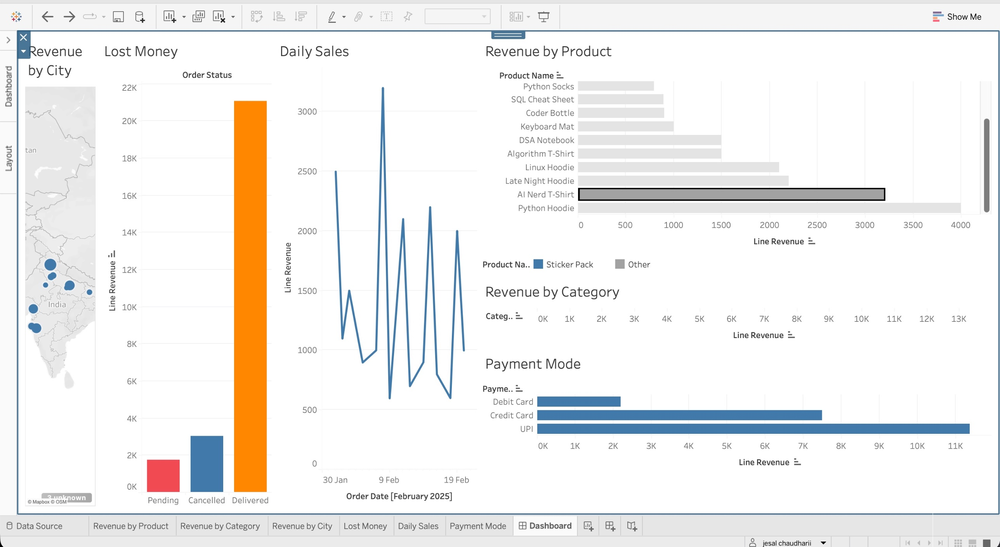

# JesalShop Sales Analysis (SQL + Tableau)

An end-to-end analytics project for a small online store that sells coder merchandise (hoodies, mugs, notebooks, stickers).
I designed the database in **MySQL**, wrote the analysis queries, found and fixed a data error, and built an interactive **Tableau** dashboard.



---

## What I Built

| Step | Tool | What I did |
|------|------|-----------|
| 1 | MySQL | Designed 5 linked tables and loaded sample data |
| 2 | MySQL | Wrote queries for revenue, top products, top customers and cancellations |
| 3 | MySQL | Checked the data, found a wrong payment and fixed it |
| 4 | MySQL | Joined all tables into one flat file for Tableau |
| 5 | Tableau | Built 6 charts and combined them into one interactive dashboard |

## Database Design

5 tables connected with primary and foreign keys:

```
customers ──< orders ──< order_items >── products
                │
                └──< payments
```

| Table | What it stores | Rows |
|-------|---------------|------|
| `customers` | name, email, city, signup date | 20 |
| `products` | name, category, price, stock | 20 |
| `orders` | customer, date, status (Delivered / Pending / Cancelled) | 20 |
| `order_items` | which products were in each order and how many | 22 |
| `payments` | payment mode (UPI, Credit Card, Debit Card), amount, date | 15 |

## SQL Skills Used

`JOIN` / `LEFT JOIN` (up to 4 tables) · `GROUP BY` · `SUM` / `COUNT` · `WHERE` · `ORDER BY` · `COALESCE` · `UPDATE` · primary and foreign keys · data validation

## Business Questions Answered

1. What is the total revenue?
2. Which products earn the most money?
3. Which customers spend the most?
4. Which products sell the most units?
5. How many orders were cancelled?

Full queries are in [`jesalshop.sql`](jesalshop.sql).

## Key Insights

Numbers below are for **Delivered** orders only (15 of 20 orders).

- **Total revenue is ₹21,075.** The average order is about ₹1,405.
- **Clothing makes 62% of sales** (₹12,993). The Python Hoodie is the top product at ₹3,998.
- **UPI is the most used payment mode** with 54% of revenue (₹11,387), ahead of Credit Card (₹7,493) and Debit Card (₹2,195).
- **Delhi is the top city** with ₹4,192, followed by Chandigarh (₹3,198).
- **Money is being lost.** Cancelled orders are worth ₹3,047 and Pending orders are worth ₹1,747. That is about **18.5% of all order value** not turned into revenue. The cancellation rate is 15% (3 of 20 orders).

## Recommendations

- Push clothing bundles, since clothing drives most of the revenue
- Offer UPI rewards or cashback to keep the most popular payment mode growing
- Follow up on Pending orders to turn ₹1,747 into real revenue
- Find out why 3 of 20 orders were cancelled
- Test local marketing in Delhi, the top city

## Data Quality Bug I Found and Fixed

While checking my numbers, I compared each payment against the items in its order.

- **Problem:** Order 9 had 3 Terminal Stickers at ₹199, which should be **₹597**. The payment table said **₹747**.
- **Cause:** ₹747 is the price of 3 *Sticker Packs* (₹249 each), so the wrong product price was used.
- **Impact:** Total revenue was overstated by ₹150 (₹21,225 instead of ₹21,075).
- **Fix:**

```sql
UPDATE payments SET amount = 597 WHERE payment_id = 7 AND order_id = 9;
```

After the fix, revenue from the payments table and revenue from price × quantity both equal **₹21,075**, which confirms the data is consistent.

## Preparing Data for Tableau

Tableau Public cannot connect to MySQL, so I joined everything into one flat table (one row per order item) and exported it as CSV:

```sql
SELECT o.order_id,
       o.order_date,
       o.order_status,
       c.name AS customer_name,
       c.city,
       p.product_name,
       p.category,
       p.price,
       oi.quantity,
       p.price * oi.quantity AS line_revenue,
       COALESCE(pay.payment_mode, 'Not Paid') AS payment_mode
FROM order_items oi
JOIN orders o ON oi.order_id = o.order_id
JOIN customers c ON o.customer_id = c.customer_id
JOIN products p ON oi.product_id = p.product_id
LEFT JOIN payments pay ON o.order_id = pay.order_id;
```

`LEFT JOIN` keeps Cancelled and Pending orders (which have no payment) so they can appear in the "Lost Money" chart.

## Dashboard Charts

1. Revenue by Product
2. Revenue by Category
3. Revenue by City (map)
4. Payment Mode
5. Lost Money (Delivered vs Cancelled vs Pending)
6. Daily Sales

Clicking any bar filters all the other charts.

## Files in This Repo

| File | What it is |
|------|-----------|
| `jesalshop.sql` | Database, data and analysis queries |
| `jesalshop_tableau.csv` | All tables joined into one file for Tableau |
| `jesalshop.twbx` | Tableau workbook |
| `dashboard.jpg` | Screenshot of the dashboard |

## How to Run It

1. Open **MySQL Workbench** and run `jesalshop.sql`.
2. Open **Tableau Public** and connect to `jesalshop_tableau.csv`.
3. Or open `jesalshop.twbx` to see the finished dashboard.

## Limitations and Next Steps

- This is sample data: 20 orders in one month (February 2025), so trends are for practice only
- Next: add more months, calculate repeat-customer rate, add a low-stock alert, and study cancellation reasons

---

**Author:** Jesal Chaudhari · [GitHub](https://github.com/jesalthorat-sudo)
